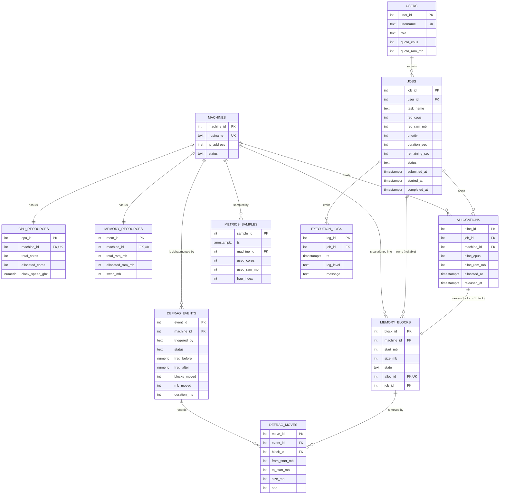
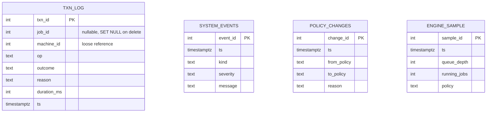

# TransactAlloc — ER Diagram

Two ways to read the same model: a Mermaid diagram (renders on GitHub / in
any Mermaid-aware viewer) and a plain-text version for the report.

## Mermaid



Standalone audit tables with no foreign keys (by design — they must survive the
deletion of the rows they describe):



## Plain-text version

```
                     +-----------+
                     |   USERS   |
                     +-----------+
                          | 1
                          | submits
                          | N
                     +-----------+
                     |   JOBS    |------< EXECUTION_LOGS   (1:N, cascade)
                     +-----------+------< ALLOCATIONS       (1:N, cascade)
                          |                    |
                          | 0..1 owns          | 1 carves
                          v                    v
                     +------------------------------+
                     |        MEMORY_BLOCKS         |  partitions a cluster's
                     | (start_mb, size_mb, state)   |  [0, total_ram_mb)
                     +------------------------------+
                          ^ N
                          | 1
   +-----------+     +-----------+
   | CPU_RES.  |1:1  | MACHINES  |1:1  | MEMORY_RES. |
   +-----------+-----+-----------+-----+-------------+
                          | 1
        +-----------------+------------------+
        | N                                  | N
   +--------------+                  +----------------+
   | ALLOCATIONS  |                  | DEFRAG_EVENTS  |
   +--------------+                  +----------------+
                                            | 1
                                            | N
                                     +--------------+
                                     | DEFRAG_MOVES |
                                     +--------------+
```

## Cardinalities that matter

| Relationship | Cardinality | Why |
|---|---|---|
| `Users → Jobs` | 1:N | one submitter, many jobs; quota is enforced over this set |
| `Machines → CPU_Resources` / `Memory_Resources` | 1:1 | a cluster has exactly one CPU pool and one RAM pool (UNIQUE `machine_id`) |
| `Jobs → Allocations` | 1:N | a job can hold resources on more than one cluster over its life (and, in a split allocation, at once) |
| `Allocations → Memory_Blocks` | 1:1 | each allocation carves exactly one contiguous block; a NULL-`alloc_id` block is free RAM |
| `Machines → Memory_Blocks` | 1:N | the block map is a partition, so this is total and disjoint |
| `Memory_Blocks → Defrag_Moves` | 1:N | one block can appear in many past defragment runs |
| `Defrag_Events → Defrag_Moves` | 1:N | a run is an ordered list of moves (`seq`) |

## The one modelling decision worth defending

RAM is **not** a counter. It is a set of `Memory_Blocks` that always partitions
`[0, total_ram_mb)`. That is what makes external fragmentation a *query*
(`v_cluster_status.frag_index`) instead of an estimate, and what makes
"allocate the best-fit hole" or "move block X to offset Y" expressible at all.
CPU stays a counter because cores are fungible and never fragment.
